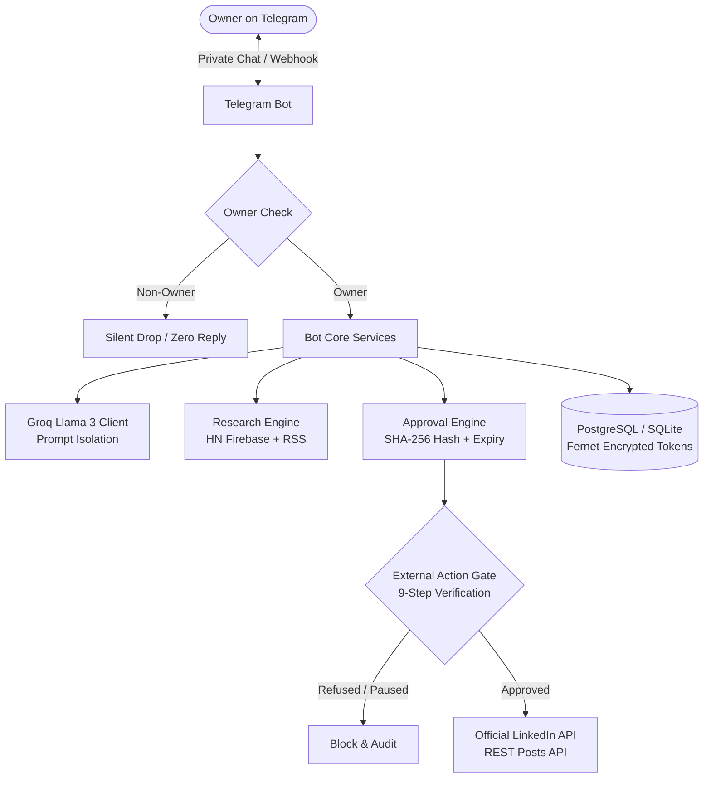

# LinkedIn Telegram AI Assistant

A private, single-owner AI assistant inside Telegram for research, drafting, and verified LinkedIn publishing. Built with strict security boundaries, exact-text approval gates, and a default-deny architecture.

---

## 🌟 Key Highlights

- **Single-Owner Privacy:** Dedicated exclusively to you. Strangers messaging the bot or tapping buttons receive zero reply and no information disclosure ([FR-001](linkedin-telegram-ai-assistant/docs/02-prd.md#L27)).
- **Exact-Text Approval Gate:** Posts are only published after your explicit tap on an Approve button bound to the exact SHA-256 content hash ([FR-006](linkedin-telegram-ai-assistant/docs/02-prd.md#L32)). Any modification to the text immediately voids the approval.
- **Untrusted Prompt Isolation:** User inputs and web research are strictly isolated inside `<untrusted_user_input>` XML tags. The AI model has no tools, no shell, and no access to secrets ([SEC-005](linkedin-telegram-ai-assistant/docs/10-agent-rules.md#L140)).
- **Encrypted Token Security:** OAuth 2.0 access tokens are encrypted at rest using Fernet (AES-128-CBC + HMAC-SHA256) ([SEC-004](linkedin-telegram-ai-assistant/docs/10-agent-rules.md#L139)).
- **Drafts-Only Mode Fallback:** Operates completely without LinkedIn credentials as an offline drafting and daily briefing assistant ([FR-020](linkedin-telegram-ai-assistant/docs/02-prd.md#L46)).
- **Zero-Cost Deployment:** Ready for deployment on free infrastructure (Render Web Service + Supabase PostgreSQL + GitHub Actions Scheduler).

---

## 🏗️ System Architecture

---

## 📋 Command Reference

### Drafting & Ideation
| Command | Description |
|---|---|
| `/draft <idea>` | Generate a draft post from an idea or topic |
| `/comment <url> <context>` | Draft a professional comment for a post |
| `/note <name> <context>` | Draft a personalized connection note (under 200 chars) |
| `/revise <code> <instruction>` | Revise an existing draft (creates a new version and voids prior approvals) |
| `/drafts` | List your recent drafts and current versions |

### Research & Daily Briefings
| Command | Description |
|---|---|
| `/report` | Generate an on-demand briefing from Hacker News and RSS feeds |
| `/trends` | Summary of top stories and industry discussions |

### Approvals & Publishing
| Command | Description |
|---|---|
| `/approve <code>` | Review exact text and generate inline Approve/Reject buttons |
| `/reject <code>` | Explicitly reject a draft approval |
| `/publish <code>` | Publish an approved draft via official LinkedIn API |

### Emergency & Status Controls
| Command | Description |
|---|---|
| `/status` | View bot state, LinkedIn connection countdown, and pending approvals |
| `/pause` | Emergency stop — immediately halts all publishing and scheduled jobs |
| `/resume` | Resume normal operations and scheduled briefings |

### LinkedIn OAuth Connection
| Command | Description |
|---|---|
| `/connect` | Generate official LinkedIn authorization URL with secure one-time state |
| `/connect_token <code> <state>` | Complete OAuth code exchange and store encrypted token |
| `/disconnect` | Disconnect LinkedIn account and return to drafts-only mode |

---

## 🚫 Strict Scope Boundaries (Default DENY)

To ensure account safety and terms-of-service compliance, the following actions are hard-coded as **strictly forbidden**:
- ❌ **No LinkedIn Scraping** in any form.
- ❌ **No Browser Automation** (No Playwright, Selenium, or headless browser scripts).
- ❌ **No Unofficial APIs** or private endpoints.
- ❌ **No Storing Passwords or Session Cookies**.
- ❌ **No Automated Likes, Comments, Direct Messages, or Connection Requests**.
- ❌ **No Bypassing the Approval Gate** — an external action cannot occur without manual owner approval.

---

## 🚀 Getting Started

Follow the step-by-step setup guide in [`SETUP-GUIDE.md`](SETUP-GUIDE.md).

For production cloud deployment instructions, review [`docs/RUNBOOK.md`](docs/RUNBOOK.md).

---

## 🔒 Security & Verification

This project implements all 31 security controls specified in [`docs/10-agent-rules.md`](linkedin-telegram-ai-assistant/docs/10-agent-rules.md). Read the complete audit verification report in [`docs/SECURITY-AUDIT-REPORT.md`](docs/SECURITY-AUDIT-REPORT.md).

---

## ⚖️ Disclaimers & Transparency (SEC-031)

1. **Non-Affiliation:** This project is an independent open-source tool and is not affiliated with, sponsored by, or endorsed by LinkedIn, Telegram, Groq, or Google.
2. **Platform Terms:** Users are solely responsible for compliance with the LinkedIn User Agreement, Telegram Terms of Service, and all applicable platform policies.
3. **No Outcome Guarantees:** This software does not guarantee professional growth, follower increases, or content engagement.
4. **Not Legal Advice:** Privacy and data protection references (including India DPDP alignment) are provided for architectural context only and do not constitute legal advice.

---

## 📄 License

Distributed under the [MIT License](LICENSE).
