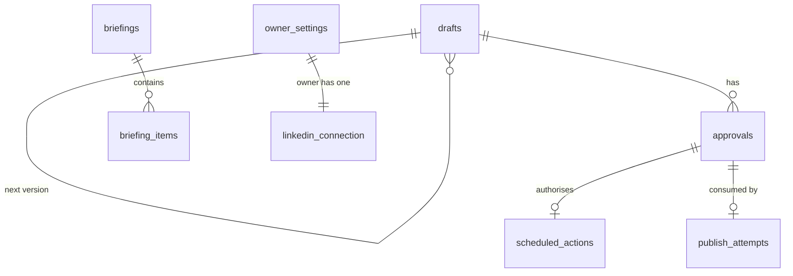
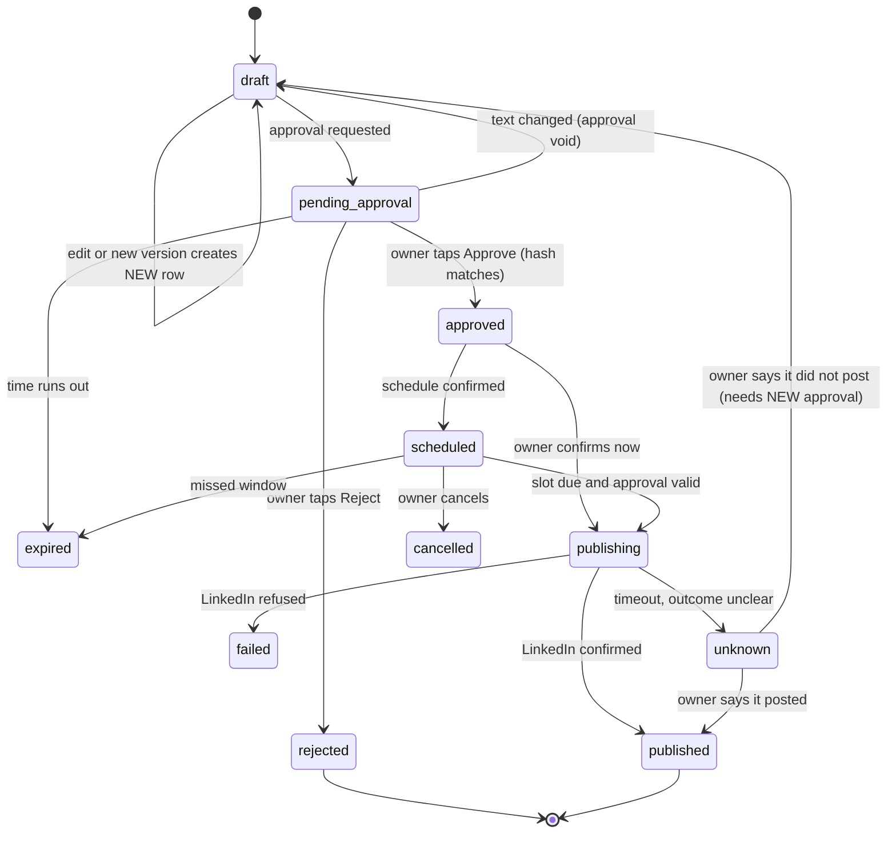

# 05 — Database Schema (proposal, not implementation)

**Version:** 0.1 — 20 October 2026
**Related files:** `02-prd.md`, `06-system-architecture.md`, `07-system-flows.md`, `10-agent-rules.md`
Evidence labels: `01-project-vision.md` section 1. This is a **proposed design**. The real code may differ; if it does, update this file.

---

## 1. Principles

1. **Single owner.** Settings and the LinkedIn connection are one-row tables.
2. **The database is the memory.** Free hosts forget; jobs read their state from here (FR-021).
3. **Approvals are rows**, tied to an exact content hash, single-use, with an expiry.
4. **No raw secrets.** The LinkedIn token is stored encrypted; no token ever goes into logs, audit rows or AI prompts (SEC-004, SEC-017).
5. **Minimal personal data about other people** (SEC-021).
6. Times are stored as UTC timestamps (NFR-005).
7. Types below are PostgreSQL names. SQLite equivalents: `uuid`→`text`, `timestamptz`→`text/datetime`, `jsonb`→`json`.

## 2. Tables (overview)

| Table | Purpose |
|---|---|
| `owner_settings` | One row: owner's preferences and feature flags |
| `linkedin_connection` | One row: encrypted token, expiry, member ID |
| `oauth_states` | One-time sign-in `state` values |
| `sources` | Configured RSS feeds and the Hacker News source |
| `seen_items` | URLs already used in briefings (avoid repeats) |
| `drafts` | Post, comment and connection-note drafts (versions) |
| `approvals` | Owner decisions tied to exact content |
| `scheduled_actions` | Future publish requests |
| `publish_attempts` | Every call made to LinkedIn to publish |
| `briefings` / `briefing_items` | Daily reports and their items |
| `job_runs` | One row per job slot (duplicate prevention) |
| `telegram_updates` | Seen Telegram update IDs (webhook retry safety) |
| `callback_tokens` | One-use button tokens |
| `audit_log` | Append-only history of important events |
| `ai_calls` | Small usage record (quota awareness) |
| `unauthorized_attempts` | Counter of stranger attempts (hashed ID) |

## 3. Column definitions

### owner_settings (exactly one row)
| Column | Type | Notes |
|---|---|---|
| id | smallint PK | CHECK (id = 1) |
| owner_telegram_id | bigint NOT NULL | Also set in environment; both must match |
| timezone | text NOT NULL default 'Asia/Kolkata' | The maintainer's default; every owner can change it |
| briefing_time | time NOT NULL default '08:00' | PROPOSED default |
| briefing_enabled | boolean default true | |
| topics | jsonb | e.g. AI, software development |
| tone | text | Configurable later (`09-content-rules.md`) |
| language | text default 'English' | |
| display_name | text null | Optional greeting name (FR-031) |
| paused | boolean NOT NULL default false | `/pause` |
| publishing_enabled | boolean NOT NULL default false | Stays false until DIS-1 solved |
| scheduling_enabled | boolean NOT NULL default false | |
| ai_fallback_enabled | boolean NOT NULL default false | Gemini |
| updated_at | timestamptz | |

### linkedin_connection (zero or one row)
| Column | Type | Notes |
|---|---|---|
| id | smallint PK | CHECK (id = 1) |
| member_urn | text | The owner's LinkedIn person ID |
| granted_scopes | text | Minimum only |
| access_token_enc | bytea NOT NULL | Encrypted; never logged |
| issued_at, expires_at | timestamptz | 60-day life (VERIFIED, V3) |
| status | text | `active`, `expired`, `revoked` |
| last_warning_days | smallint | Which warning (14/7/3/1) was sent |

### oauth_states
`state text PK`, `created_at timestamptz`, `expires_at timestamptz` (10 minutes, PROPOSED), `used_at timestamptz null`.

### sources
`id bigint PK`, `kind text` (`rss` | `hn`), `name text`, `url text null`, `topics jsonb`, `enabled boolean`. The URLs are chosen by the owner (open question Q-8); none are assumed here.

### seen_items
`url_hash char(64) PK`, `first_seen_at timestamptz`. Retention 30 days.

### drafts
| Column | Type | Notes |
|---|---|---|
| id | uuid PK | |
| code | text UNIQUE | Short code shown to owner, e.g. D-7K2F |
| kind | text NOT NULL | `post` / `comment` / `connection_note` |
| parent_id | uuid FK → drafts.id null | Previous version |
| version | int NOT NULL | |
| idea | text | Owner's idea or request |
| body | text NOT NULL | The exact text |
| content_hash | char(64) NOT NULL | SHA-256 of the exact text + visibility |
| visibility | text | `PUBLIC` / `CONNECTIONS` (posts only) |
| context_text | text null | What the owner pasted for comment or note drafts; **deleted after 7 days** |
| status | text NOT NULL | See section 6 |
| created_at, updated_at | timestamptz | |

Indexes: `(kind, status)`, `(created_at)`. Unique: `(parent_id, version)`.

### approvals
| Column | Type | Notes |
|---|---|---|
| id | uuid PK | |
| draft_id | uuid FK → drafts.id NOT NULL | |
| action_type | text NOT NULL | `publish_post`, `schedule_post` |
| content_hash | char(64) NOT NULL | Must equal the draft's hash at use time |
| run_at | timestamptz null | For scheduled approvals |
| requested_at | timestamptz NOT NULL | |
| expires_at | timestamptz NOT NULL | Default +30 min (or run_at + 30 min) |
| decision | text NOT NULL | `pending` / `approved` / `rejected` / `expired` |
| decided_at | timestamptz null | |
| decided_by_telegram_id | bigint null | Must equal owner ID |
| telegram_message_id | bigint null | |
| used_at | timestamptz null | Set once, atomically, when consumed |

Constraints: `CHECK (used_at IS NULL OR decision = 'approved')`. Partial unique index: one **unused approved** approval per `(draft_id, action_type, content_hash)`.

### scheduled_actions
`id uuid PK`, `draft_id FK`, `approval_id FK UNIQUE`, `run_at timestamptz`, `status text` (`scheduled`/`claimed`/`done`/`failed`/`cancelled`/`skipped`), `claimed_at`, `idempotency_key text UNIQUE`, `created_at`. Index `(status, run_at)`.

### publish_attempts
`id uuid PK`, `draft_id FK`, `approval_id FK UNIQUE` (one attempt per approval), `idempotency_key text UNIQUE`, `started_at`, `finished_at null`, `outcome text` (`started`/`success`/`failed`/`unknown`), `http_status int null`, `error_code text null`, `linkedin_post_id text null`. **No request bodies, no tokens.**

### briefings and briefing_items
`briefings`: `id PK`, `run_date date UNIQUE`, `status` (`building`/`ready`/`sent`/`failed`/`partial`), `sent_at`, `telegram_message_ids jsonb`, `notes text`.
`briefing_items`: `id PK`, `briefing_id FK`, `position int`, `title text`, `url text`, `source_name text`, `published_at timestamptz null`, `fact_text text`, `interpretation_text text` (**two columns on purpose**: facts vs AI opinion). Index `(briefing_id, position)`.

### job_runs
`id PK`, `job_name text`, `slot timestamptz` (the time slot the job was for), `started_at`, `finished_at`, `status`, `error_summary text`. **UNIQUE (job_name, slot)** — this is the duplicate-job guard.

### telegram_updates
`update_id bigint PK`, `received_at`. Retention 7 days.

### callback_tokens
`token text PK`, `purpose text`, `draft_id uuid null`, `approval_id uuid null`, `created_at`, `expires_at`, `used_at null`.

### audit_log (append-only)
`id bigint PK`, `ts timestamptz`, `actor text` (`owner`/`system`/`ai`), `event text`, `entity_type text`, `entity_id text`, `outcome text`, `details jsonb` (sanitised, no secrets). The application account has INSERT and SELECT only (SEC-016).

### ai_calls
`id PK`, `ts`, `provider`, `purpose`, `status`, `http_status`. Retention 30 days. No prompts or outputs stored.

### unauthorized_attempts
`id PK`, `ts`, `id_hash char(64)`. Hash uses a secret salt. Retention 30 days.

## 4. Relationships



## 5. Example schema fragments (illustration only)

```sql
-- approvals: single-use is enforced by the database, not only by code
CREATE TABLE approvals (
  id uuid PRIMARY KEY,
  draft_id uuid NOT NULL REFERENCES drafts(id),
  action_type text NOT NULL,
  content_hash char(64) NOT NULL,
  expires_at timestamptz NOT NULL,
  decision text NOT NULL CHECK (decision IN ('pending','approved','rejected','expired')),
  used_at timestamptz,
  CHECK (used_at IS NULL OR decision = 'approved')
);
CREATE UNIQUE INDEX one_unused_approval
  ON approvals (draft_id, action_type, content_hash)
  WHERE decision = 'approved' AND used_at IS NULL;

-- jobs: the slot makes duplicates impossible
CREATE UNIQUE INDEX job_slot_once ON job_runs (job_name, slot);
```

## 6. Draft status transitions


Only the code path named in `06-system-architecture.md` may move a draft into `publishing`, and only inside one database transaction that also sets `approvals.used_at`.

## 7. Idempotency strategy

- **Telegram:** `telegram_updates.update_id` — process each update once.
- **Buttons:** `callback_tokens` — one use each.
- **Jobs:** `job_runs UNIQUE (job_name, slot)` — the tick inserts the row first; if the insert fails, someone already did it.
- **Publishing:** one `publish_attempts` row per approval (`approval_id UNIQUE`). The approval is marked used **in the same transaction** that creates the attempt row, **before** calling LinkedIn. If the call times out the outcome is `unknown` and there is **no automatic retry**. A new publish needs a new approval, after the owner has checked LinkedIn. Whether LinkedIn offers its own duplicate protection is `UNKNOWN — CHECK OFFICIAL DOCUMENTATION`; we do not rely on it.

## 8. Migration strategy

Alembic, numbered migrations, reviewed by you before applying. Run migrations on a copy first. Keep one migration per change. Test upgrades on SQLite and PostgreSQL. Take a backup before every production migration.

## 9. Retention and deletion

| Data | Keep | Deletion |
|---|---|---|
| Drafts, history | 12 months (PROPOSED) or until you delete | `/settings` delete |
| `context_text` (pasted material) | 7 days | Automatic |
| Briefings | 90 days | Automatic |
| `seen_items` | 30 days | Automatic |
| `telegram_updates` | 7 days | Automatic |
| `ai_calls`, `unauthorized_attempts` | 30 days | Automatic |
| Audit log | 12 months | Automatic, never edited |
| LinkedIn token | Until expiry or revoke | Deleted on `revoked` or wipe |

Foreign keys use `ON DELETE RESTRICT` for approvals and publish attempts (history must not vanish silently); the wipe command deletes in the correct order inside one transaction. Backups follow the same retention; a deleted item may remain in an older backup until that backup expires (SEC-023).

## 10. Data not stored

Names, profiles or messages of other LinkedIn members by default; LinkedIn passwords or cookies; raw tokens in any log; Telegram messages from strangers.

## 11. Sources

V3 (token life). BRIEF-VERIFIED: B19 https://www.pib.gov.in/PressReleasePage.aspx?PRID=2190014&lang=2&reg=48 (India DPDP Rules), B47 https://learn.microsoft.com/en-us/linkedin/marketing/restricted-use-cases?view=li-lms-2026-09 (limits on using member data). Backup features of Supabase free tier: UNKNOWN — CHECK OFFICIAL DOCUMENTATION.

## What I skipped or could not check

- No SQL was run. The schema is untested.
- Whether Supabase free includes automatic backups, and database size limits: unknown.
- Row-level permissions on Supabase for the app account need a design check at build time.
- Your decisions: retention periods, approval expiry, whether to keep `context_text` at all.
