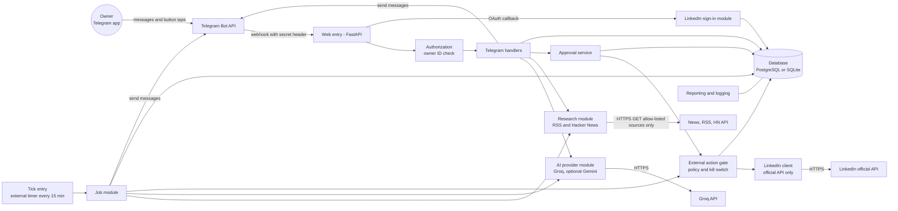
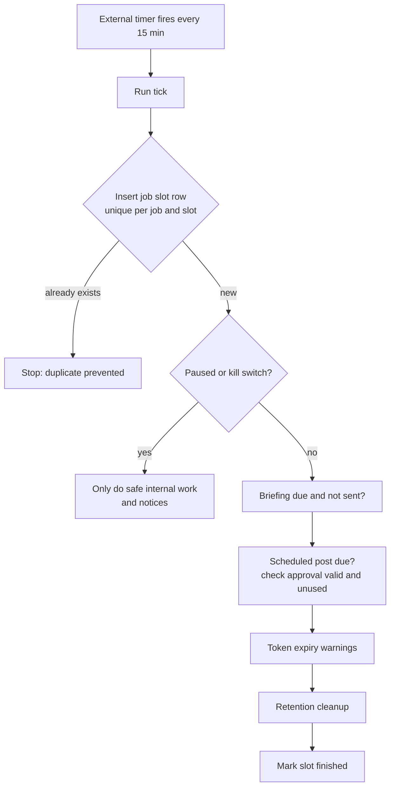
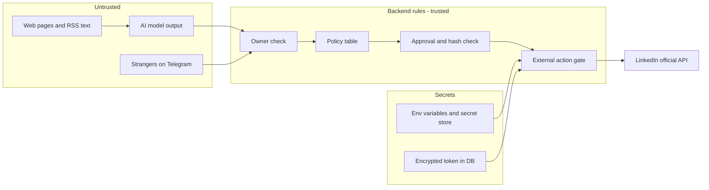

# 06 — System Architecture

**Version:** 0.1 — 20 October 2026
**Related files:** `03-tech-stack.md`, `05-database-schema.md`, `07-system-flows.md`, `10-agent-rules.md`, `13-free-technologies-and-deployment.md`
Evidence labels: `01-project-vision.md` section 1.

---

## 1. Overview

A **modular monolith**: one Python application, split into clear parts (modules). It is deployed as two entry points that share the same code and database:

1. **Web entry** (FastAPI): receives Telegram webhook calls and the LinkedIn sign-in callback.
2. **Tick entry** (a command): run every ~15 minutes by an external trigger; does all time-based work from database state.

No Redis, Celery, microservices, Kubernetes, or multiple AI agents (nothing in the requirements justifies them).

## 2. Component responsibilities

| Module | Does | Must never |
|---|---|---|
| Telegram handlers | Turn commands and button taps into actions; format replies | Call LinkedIn directly |
| Authorization | Check the Telegram user ID on **every** update and callback (SEC-001, SEC-002) | Trust any ID from message text |
| AI provider | Send text to Groq (or optional Gemini), return text | Receive secrets, tokens or private data; call tools; decide actions |
| Research | Fetch only owner-configured sources, clean text, deduplicate | Fetch LinkedIn; follow links to arbitrary hosts |
| Approval service | Create, validate, expire and consume approvals (FR-006) | Approve on its own; accept an ID other than the owner's |
| External action gate | The **only** door to LinkedIn: checks policy table, pause flag, kill switch, approval, token, idempotency | Be bypassed; be called from the AI module |
| LinkedIn client | Make official API calls the gate allows (sign-in, create own post) | Scrape, automate a browser, use unofficial APIs, hold passwords or cookies |
| LinkedIn sign-in | OAuth flow with one-time `state`; store encrypted token | Ask for more scope than needed |
| Job module | The tick: briefing, due scheduled posts, expiry warnings, cleanup | Execute a LinkedIn action just because a timer fired |
| Database | Persist everything (`05-database-schema.md`) | Store raw tokens in logs/audit |
| Reporting and logging | Audit log, job history, redacted logs | Log secrets or full private texts |

## 3. Integrations

### Telegram
Webhook (recommended on sleeping hosts) with `secret_token`; Telegram sends it in the header `X-Telegram-Bot-Api-Secret-Token` (**VERIFIED**, V8). Ports 443, 80, 88, 8443; HTTPS only. Long polling is the alternative on an always-on VM (only one method at a time, B22). Update IDs are stored to ignore repeats.

### AI
One small function: "give prompt, get text". Groq is default. Gemini only if the owner turned it on, and only for public text (V9: free tier content may improve Google products). **The model has no tools, no database access and no shell.** Its output is treated as untrusted text (SEC-011, SEC-012).

### Research
Allow-list of sources the owner set (RSS URLs, Hacker News API, B15). Fetches have a size and time limit. Private and local network addresses are blocked (protects against being tricked into fetching internal addresses). Pages are cleaned to plain text and passed to the AI inside a clearly marked "untrusted data" block.

### LinkedIn
Official OAuth 2.0: owner signs in once, approves, app receives a token (B4). Open products: **Sign in with LinkedIn** and **Share on LinkedIn** (`w_member_social`, VERIFIED V1). Token life 60 days, no automatic refresh for normal developers (VERIFIED, V3). Posting endpoint: **UNCONFIRMED** (DIS-1: `/v2/ugcPosts` per V1 vs `/rest/posts` with a `Linkedin-Version` header per V2). The LinkedIn API version must be checked at build time because old versions are retired on a schedule (B9).

### Database
PostgreSQL (Supabase free) in production, SQLite locally. Free Postgres may pause after low activity (V11).

## 4. The scheduler design

- Missed ticks: the next tick sees "due and not done" and catches up once (FR-021).
- A scheduled post whose window passed (default 30 minutes) is **skipped**, the owner is told, and new approval is needed.

## 5. Background jobs

| Job | Trigger | Idempotency |
|---|---|---|
| Daily briefing | Tick, when owner's time has passed and no briefing row for today | `briefings.run_date UNIQUE` |
| Scheduled publish | Tick, when `run_at` reached | `approval_id UNIQUE` in attempts |
| Token warnings | Tick | `last_warning_days` |
| Cleanup | Tick, once a day | Safe to repeat |
| Retry of failed briefing delivery | Tick, max 3 tries | Attempt counter |

## 6. Hosting and deployment

See `13-free-technologies-and-deployment.md`. Summary:
- **Architecture B (start here):** Render free web service for the web entry; GitHub Actions schedule for the tick; Supabase for the database.
- **Architecture A (upgrade path):** one Oracle Cloud Always Free VM for both entries and a system cron for the tick.
- Antigravity is only for writing code; it is not the host.
- No guarantee of 24/7 uptime on any free option.

## 7. Logging and monitoring

- Structured logs with a redaction step that removes tokens, keys and message bodies (SEC-017).
- `job_runs` and `audit_log` are the monitoring: `/status` shows last briefing, last tick, token days left.
- Missed tick alert: if no tick has run for more than 2 hours, the next web request notices and tells the owner. (A completely silent outage cannot alert you without an extra free uptime monitor: `UNKNOWN — CHECK OFFICIAL DOCUMENTATION`.) On GitHub Actions the schedule itself can be switched off after 60 days without repository activity (V13), which looks exactly like this silent outage.
- Dependency and secret scanning in the repository (SEC-018, SEC-019).

## 8. Data flows

**Post:** idea → handler → AI → draft row → approval row (hash) → owner taps → gate checks → LinkedIn client → attempt row → result message → audit row.
**Briefing:** tick → research → AI summary (facts and interpretation separate) → briefing rows → Telegram message.
**Comment or note:** pasted text → AI → drafts shown → owner copies and posts by hand → nothing sent to LinkedIn.

## 9. Security boundaries

Rules: untrusted content can only become **text drafts**; only the backend decides actions; the AI never sees secrets; the gate does not accept AI-provided endpoints, author IDs, headers or visibility values — those come from configuration (SEC-012).

## 10. Deployment options (planning level)

1. **Local development:** SQLite, mock APIs, polling mode on your computer, no real LinkedIn token.
2. **Staging test:** real Telegram bot (private), mocked LinkedIn. Optional.
3. **Production:** Architecture B or A, with `publishing_enabled = false` until DIS-1 is resolved by a manual test in your developer app.

## 10A. Open-source deployment model (D-2)

- **One codebase, many independent deployments.** Every owner runs their own copy. There is no central server, shared database or shared account (FR-030, SEC-030).
- **Settings only from the owner's environment** (FR-028). The repository holds placeholders only, and the app refuses to start on them.
- **Outbound allow-list:** only `api.telegram.org`, the chosen AI provider, owner-configured research sources, the owner's database, and LinkedIn's official API hosts when publishing is on. Exact host names: `UNKNOWN — CHECK OFFICIAL DOCUMENTATION` for each provider at build time.
- **Hard-coded policy:** the policy table from `10-agent-rules.md` lives in code. Settings may disable features; they cannot enable a forbidden action.
- **LinkedIn is optional:** with no LinkedIn settings the app starts in **drafts-only mode** and the gate refuses every LinkedIn action with an explanation.
- **Schedules need care:** on GitHub, forks start with schedules off and quiet public repos lose them after 60 days (V13). See `13-free-technologies-and-deployment.md` section 7A.

## 11. Requirement trace

| Requirement | Where in this file |
|---|---|
| FR-001 | Authorization, section 2 |
| FR-006, FR-007 | Approval service, gate, section 2 and 8 |
| FR-010, FR-021 | Scheduler design, section 4 |
| FR-017 | Gate, section 2 |
| NFR-002 | Logging, section 7 |
| SEC-011, SEC-012 | AI and boundaries, sections 3 and 9 |
| SEC-013, SEC-014 | Gate and attempts table |
| FR-028 to FR-031, SEC-026, SEC-030 | Open-source model, section 10A |

## 12. Sources

V1, V2, V3, V7, V8, V11 (`01-project-vision.md` section 13). BRIEF-VERIFIED: B4 https://learn.microsoft.com/en-us/linkedin/shared/authentication/getting-access, B9 https://learn.microsoft.com/en-us/linkedin/marketing/community-management-app-review?view=li-lms-2026-04, B15 https://github.com/HackerNews/API, B22 https://core.telegram.org/bots/faq.

## What I skipped or could not check

- Nothing here was built or run; the diagrams are designs. Mermaid syntax was written carefully but not rendered by me.
- The LinkedIn posting endpoint for personal profiles is unproven (DIS-1).
- Free uptime monitoring options were not researched.
- Your decisions: Architecture A or B; the 15-minute tick; the 2-hour silence rule.
