# 07 — System Flows

**Version:** 0.1 — 20 October 2026
**Related files:** `04-telegram-bot-design.md`, `05-database-schema.md`, `06-system-architecture.md`, `10-agent-rules.md`
Evidence labels: `01-project-vision.md` section 1. Every flow is a **design**, nothing has been run.

Requirement references use `FR-`, `SEC-` IDs from `02-prd.md` and `10-agent-rules.md`.

---

## Flow 1 — Starting the bot

Goal: the app starts safely and refuses to run if the basics are missing.
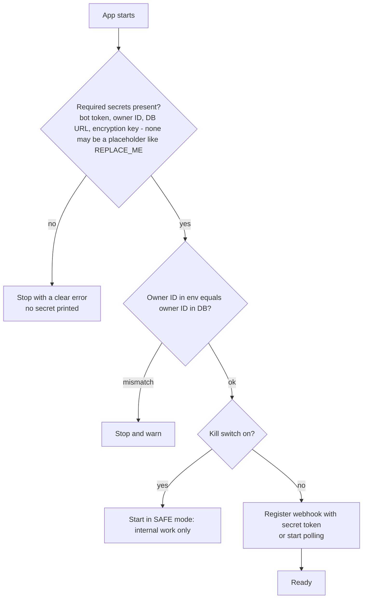
On a sleeping host, a cold start happens whenever Telegram calls after idle time (about 1 minute to wake, V7).

## Flow 2 — Authorizing the owner (every update)

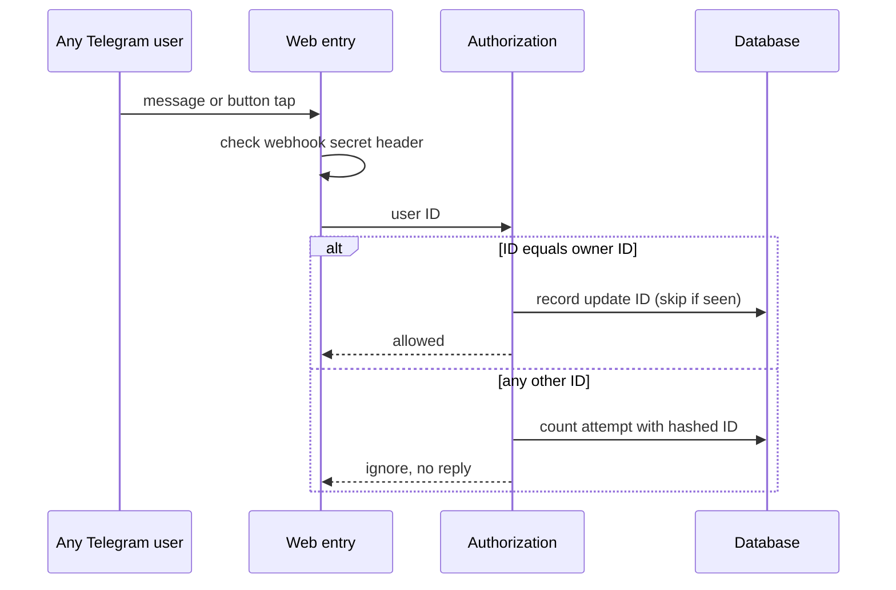
Applies to messages **and** callback queries (SEC-001, SEC-002).

## Flow 3 — Generating a post draft

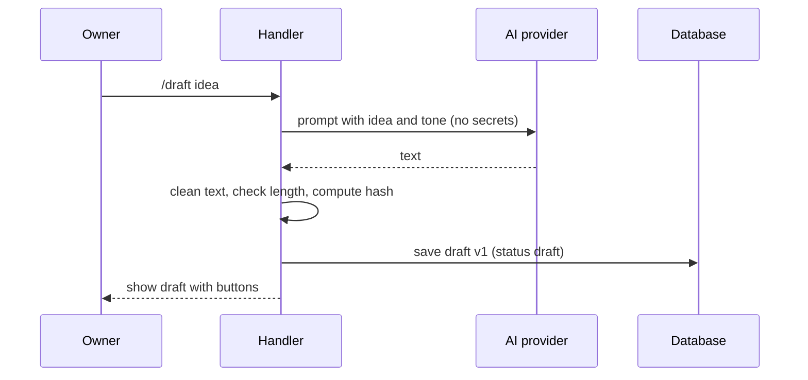
If the AI is unavailable: "The AI is not available right now. Your idea is saved" (FR-022).

## Flow 4 — Approving and publishing a post

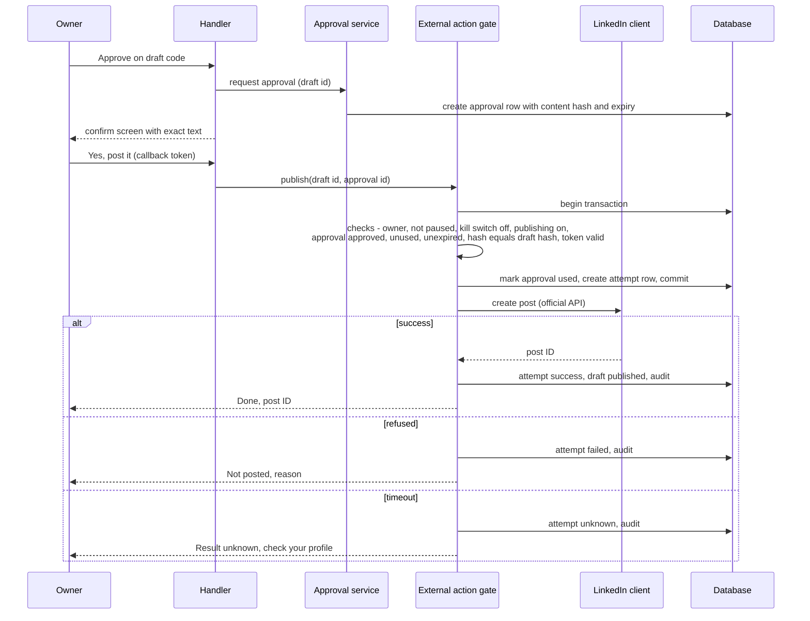
If any check fails, nothing is sent to LinkedIn and the owner gets the exact reason (FR-007, FR-025).

## Flow 5 — Rejecting a draft

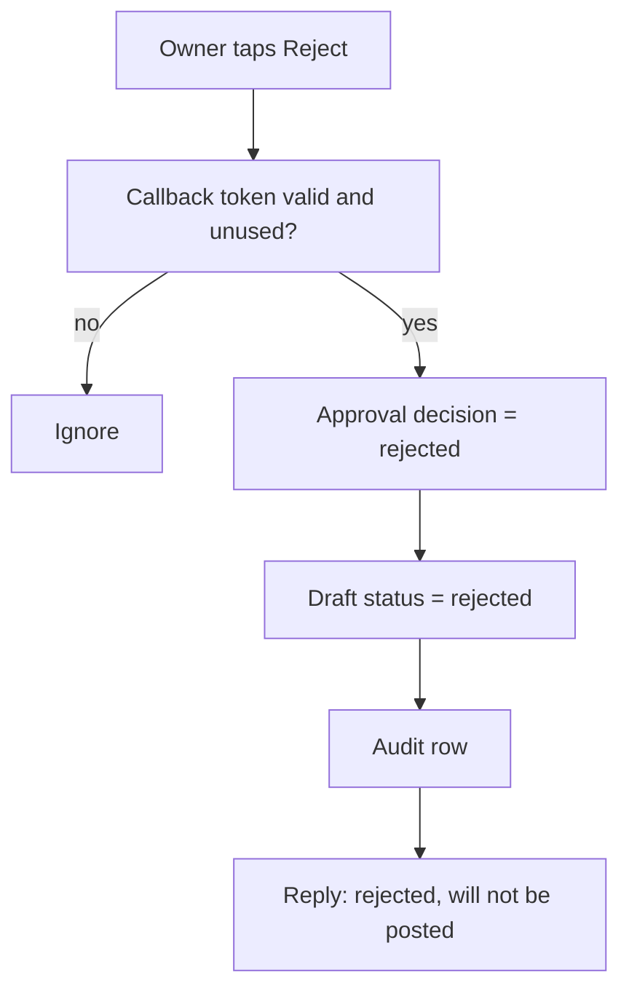
A rejected approval can never be used (database check).

## Flow 6 — Scheduling a post

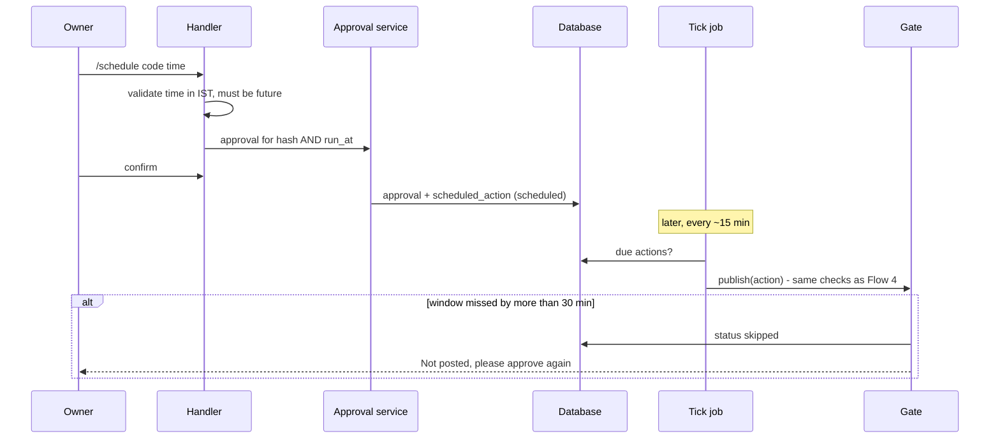
A timer alone is never enough; the gate re-checks the approval (SEC-013).

## Flow 7 — Generating the daily briefing

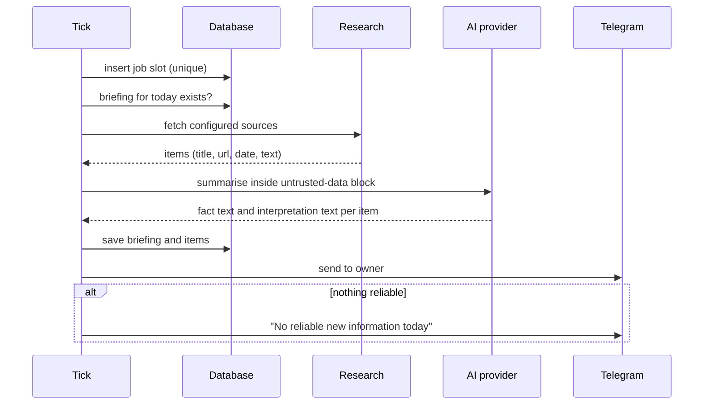
Failures: AI quota out → headlines only; source down → listed as failed; Telegram delivery fails → retry up to 3 ticks, then a failure notice (FR-021, FR-022).

## Flow 8 — Generating comment drafts

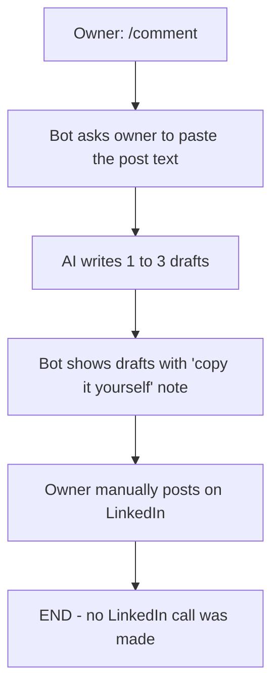

## Flow 9 — Generating connection-note drafts

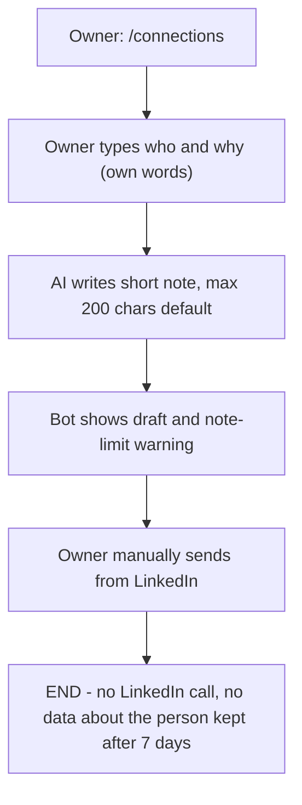

## Flow 10 — Token expiration and reauthorization

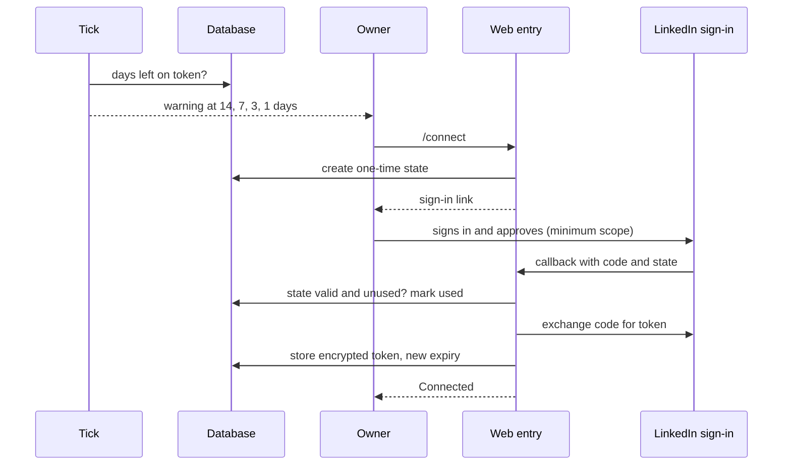
Token life is 60 days; normal developers cannot refresh automatically (V3).

## Flow 11 — API failure and retry

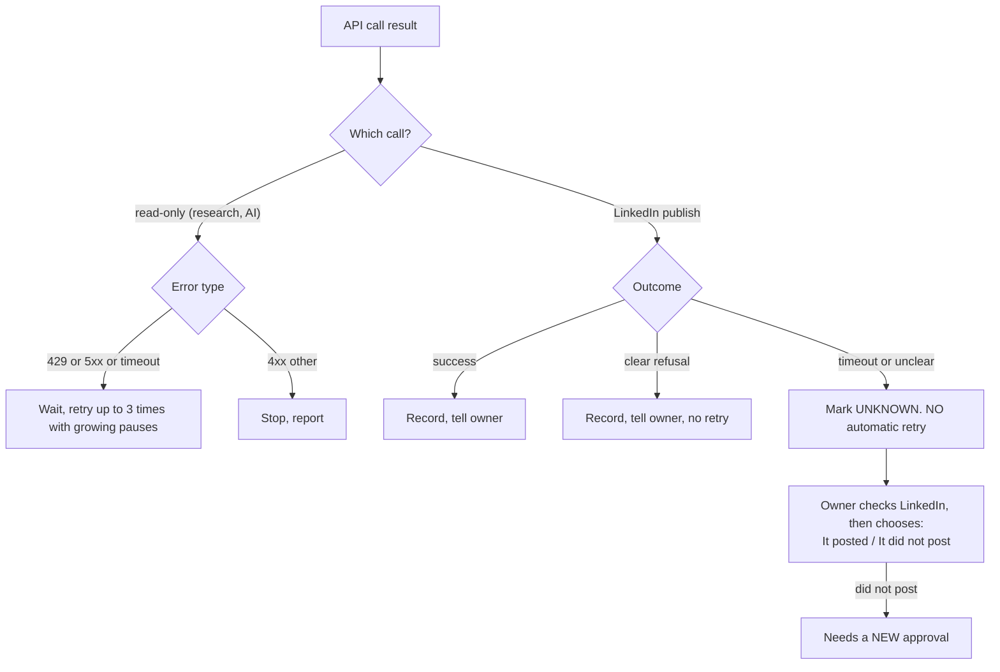

## Flow 12 — Duplicate-job prevention

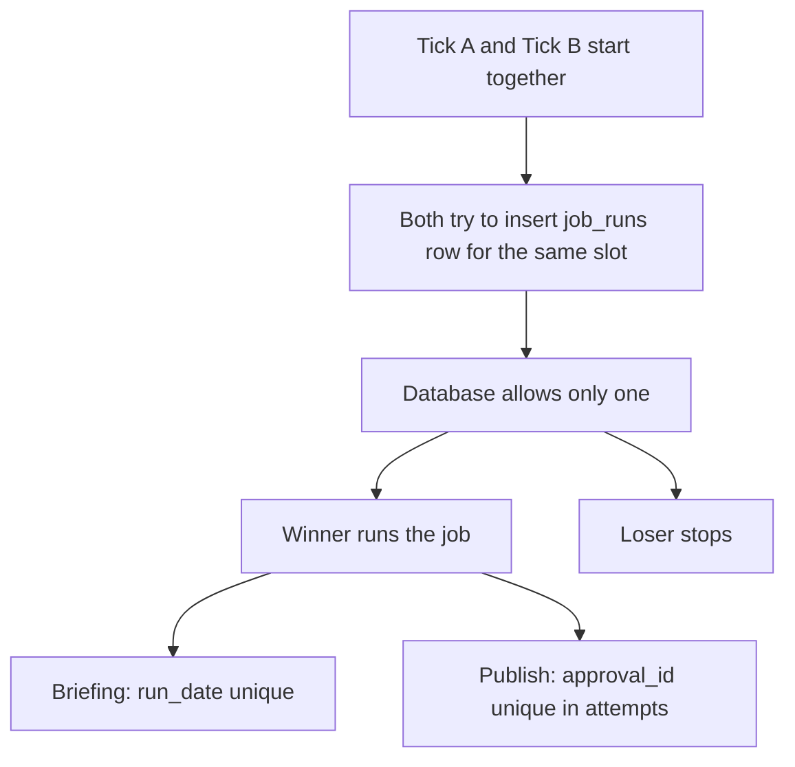

## Flow 13 — Unauthorized-user attempts

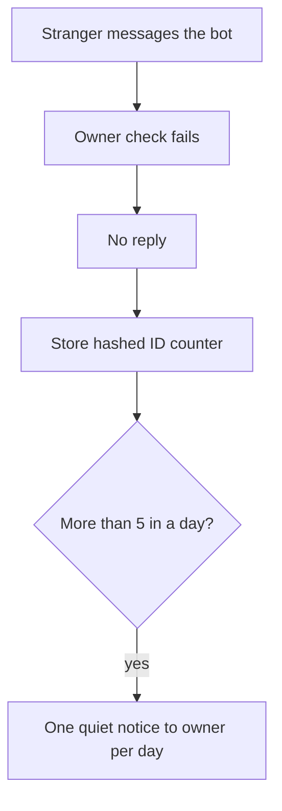

## Flow 14 — Emergency shutdown

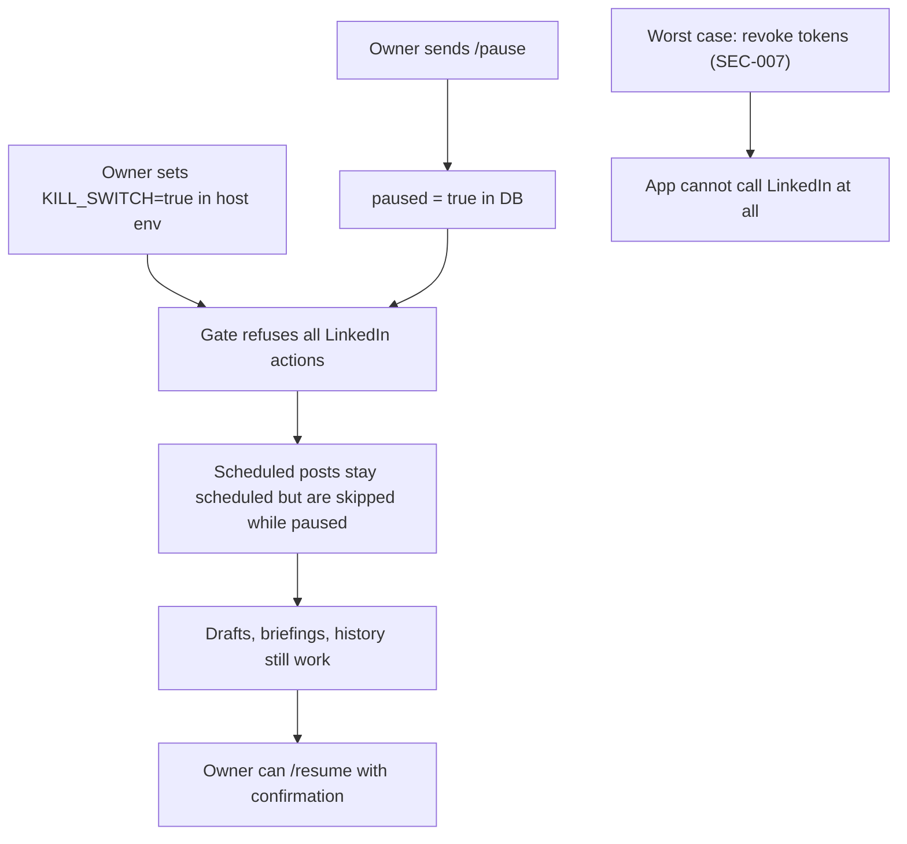
The environment kill switch works even if the bot or database is unreachable, because the gate reads it first.

## Flow 15 — First-time setup by a new owner (open-source model)

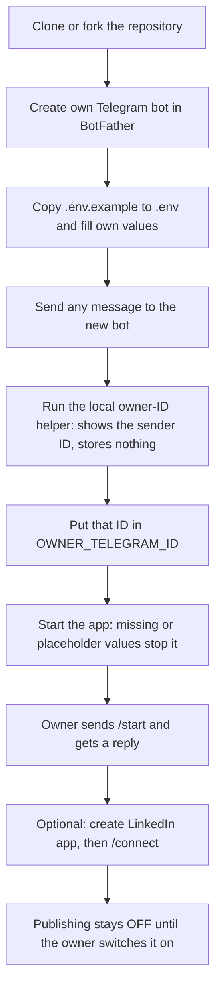
Notes: the helper uses long polling, so run it **before** setting a webhook (only one method works at a time, B22). A stranger who finds the bot gets nothing (FR-001). On a fork, GitHub schedules start disabled (V13), so the owner must switch the tick on (see `SETUP-GUIDE.md`).

## Sources

V1, V2, V3, V7, V8 (`01-project-vision.md` section 13); B22 https://core.telegram.org/bots/faq.

## What I skipped or could not check

- Flows were not simulated or run; retry counts (3), warning days, 5-attempts rule and 30-minute window are PROPOSED values.
- LinkedIn's duplicate-post behaviour is unknown, so Flow 11 assumes none.
- Mermaid diagrams were not rendered by me; check them in a Markdown viewer that supports Mermaid.
- Your decisions: those numbers, and what you want when a briefing fails (open question Q-13).
