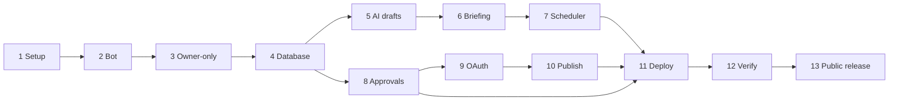

# 12 — Implementation Plan

**Version:** 0.1 — 20 October 2026
**Related files:** `PONYTAIL.md`, `03-tech-stack.md`, `05-database-schema.md`, `06-system-architecture.md`, `10-agent-rules.md`, `14-antigravity-master-prompt.md`
Evidence labels: `01-project-vision.md` section 1.

**This is a plan. No step has been started.** Each step is small and testable. Follow `PONYTAIL.md` (full mode) when coding. Use mock data and fake secrets in tests. Folder and file names below are suggestions; the final code may differ.

General rule for every phase: run the tests and **report the real results**; never claim an untested integration works; if something fails, stop and report instead of switching to another method.

There is **no phase for comment or like automation** (forbidden or blocked).

---

## Phase 1 — Environment and repository setup

- **Goal:** an empty, safe project that runs tests.
- **Prerequisites:** GitHub account, Antigravity installed, Python installed, answers to the blocking questions in `15-open-questions.md`.
- **Files expected to change:** new repo; `README.md`, `SETUP-GUIDE.md`, `SECURITY.md`, `CONTRIBUTING.md`, `.gitignore`, `.env.example` (placeholders only), a license file (your choice, Q-25), dependency lock file, `docs/` (the 15 files), CI config.
- **Work to perform:**
  1. Create the repository **private first**. Make it public only after the Phase 13 checks (history scan, placeholders only). Public repos get free scheduled runs (B31), but those switch off after 60 days without activity (V13); see `13-free-technologies-and-deployment.md` section 7A.
  2. Copy the 15 documents in.
  3. Add `.gitignore` that blocks `.env`.
  4. Add a simple test and lint command; add secret scanning.
- **Test cases:** test command passes with a trivial test; a fake secret in a test file is caught by the scanner.
- **Acceptance criteria:** clean checkout runs tests; no real secret in the repo.
- **Expected output:** green test run.
- **Failure conditions:** `.env` committed; scanner off.
- **Security considerations:** SEC-003, SEC-006, SEC-019.

## Phase 2 — Basic Telegram bot

- **Goal:** the bot replies to `/start` on your computer.
- **Prerequisites:** Phase 1; a bot token from @BotFather (B20).
- **Files expected to change:** Telegram handlers module, config module, tests.
- **Work to perform:** 1) Load all settings from the environment and refuse missing or placeholder values (FR-028). 2) Handle `/start` and `/help`. 3) Run in polling mode locally.
- **Test cases:** unit test calls the handler with a fake update.
- **Acceptance criteria:** `/start` returns the welcome message.
- **Expected output:** a working local chat.
- **Failure conditions:** token printed in logs.
- **Security considerations:** SEC-003, SEC-017.

## Phase 3 — Owner-only authentication

- **Goal:** only the owner can use anything.
- **Prerequisites:** Phase 2; `OWNER_TELEGRAM_ID` set.
- **Files expected to change:** authorization module, handler wrapper, tests.
- **Work to perform:** 1) One check at the start of every update, including button callbacks. 2) Unauthorized: no reply. 3) Store the update ID to ignore repeats. 4) Add the local owner-ID helper (FR-029): it runs before any webhook is set and stores nothing.
- **Test cases:** non-owner message, non-owner callback, owner message, missing owner setting (app refuses to start).
- **Acceptance criteria:** FR-001 tests pass; fuzz test over all handlers passes.
- **Expected output:** passing authorization test suite.
- **Failure conditions:** any handler reachable without the check.
- **Security considerations:** SEC-001, SEC-002.

## Phase 4 — Database and persistence

- **Goal:** settings, drafts, approvals, audit and job tables exist with migrations.
- **Prerequisites:** Phase 3; `05-database-schema.md` reviewed by you.
- **Files expected to change:** models, migrations, database module, tests.
- **Work to perform:** 1) Create tables for local SQLite first. 2) Add Alembic migrations. 3) Add constraints (single-use approvals, unique job slots). 4) Run the same migrations on PostgreSQL (Supabase free) with a test project.
- **Test cases:** constraint tests (cannot mark a rejected approval used; cannot insert a duplicate job slot); migration up and down.
- **Acceptance criteria:** tests pass on SQLite **and** PostgreSQL.
- **Expected output:** working schema and a backup note.
- **Failure conditions:** type differences break one database; Supabase project paused (V11).
- **Security considerations:** SEC-016, SEC-021, SEC-023.

## Phase 5 — AI drafting

- **Goal:** `/draft` produces and saves a post draft.
- **Prerequisites:** Phase 4; Groq account, one key in environment; your decision on tone.
- **Files expected to change:** AI module, draft service, content-rule checks, tests.
- **Work to perform:** 1) One function "prompt in, text out" for Groq. 2) Build prompts from allowed fields only. 3) Apply `09-content-rules.md` checks (length, no invented links). 4) Version and hash drafts. 5) Handle 429 and errors (FR-022).
- **Test cases:** mock AI success, 429, timeout; prompt builder with fake secret never leaks it; injection text in the idea does not change behaviour.
- **Acceptance criteria:** FR-004, FR-005 tests pass; edits create new versions and void approvals.
- **Expected output:** drafts in chat, saved in database.
- **Failure conditions:** AI output used as anything but text; more than one Groq account used.
- **Security considerations:** SEC-005, SEC-011, SEC-012, SEC-015; Groq policy (V6).

## Phase 6 — Research and daily briefing

- **Goal:** `/report` and `/trends` work from legal sources.
- **Prerequisites:** Phase 5; owner's topics and sources (Q-7, Q-8).
- **Files expected to change:** research module, briefing service, tests.
- **Work to perform:** 1) Fetch Hacker News API and configured RSS feeds only (allow-list, size and time limits, block private addresses). 2) Clean text. 3) Ask AI to produce fact line and interpretation line per item inside an "untrusted data" block. 4) Remove any URL not found in the fetched data. 5) Empty-day message.
- **Test cases:** mock feeds; hidden instruction in a page; unreachable source; zero items; AI unavailable (headlines only).
- **Acceptance criteria:** FR-010, FR-012 tests pass; the phrase "trending on LinkedIn" never appears.
- **Expected output:** a briefing in chat on demand.
- **Failure conditions:** invented items or links; any fetch of linkedin.com.
- **Security considerations:** SEC-011, SEC-012, SEC-021.

## Phase 7 — Scheduler and reliable delivery

- **Goal:** the briefing arrives by itself at the owner's time.
- **Prerequisites:** Phase 6.
- **Files expected to change:** tick command, job module, settings handlers, CI schedule file, tests.
- **Work to perform:** 1) One tick command. 2) Insert job slot first (unique). 3) Briefing due check, catch-up, delivery retry up to 3 ticks, failure notice. 4) Token warnings and cleanup. 5) Schedule the tick every ~15 minutes (GitHub Actions or cron).
- **Test cases:** run tick twice for one slot; skip a tick; time zone conversion IST/UTC; delivery failure.
- **Acceptance criteria:** FR-011, FR-021 tests pass; real run shows briefing within the 30-minute target on most days (NFR-004, measured for one week).
- **Expected output:** briefing at the chosen time.
- **Failure conditions:** double briefings; missed days with no notice.
- **Security considerations:** SEC-015, SEC-017; extra secret locations (GitHub and host).

## Phase 8 — Approval workflows

- **Goal:** Approve and Reject buttons with exact-text approvals, tested without LinkedIn.
- **Prerequisites:** Phase 4, 5.
- **Files expected to change:** approval service, handlers, callback tokens, tests.
- **Work to perform:** 1) Approval row with hash, expiry, single-use. 2) Buttons with one-use tokens. 3) Confirmation screen. 4) Pause, resume, kill switch. 5) Audit rows.
- **Test cases:** the SEC-013 list: edited text, expired, reused, rejected, other user, replayed button.
- **Acceptance criteria:** FR-006, FR-017, FR-027 pass.
- **Expected output:** full approval flow using a **fake publisher**.
- **Failure conditions:** any path reaches the (fake) publisher without a valid approval.
- **Security considerations:** SEC-002, SEC-013, SEC-024.

## Phase 9 — LinkedIn OAuth

- **Goal:** link the owner's LinkedIn account safely.
- **Prerequisites:** Phase 8; LinkedIn Page, super admin approval (B44; answer Q-1, Q-2, Q-3); a deployed HTTPS callback (or a local test route); developer app with Sign in with LinkedIn and Share on LinkedIn.
- **Files expected to change:** LinkedIn sign-in module, `/connect`, encrypted token storage, tests.
- **Work to perform:** 1) One-time `state` values. 2) Request minimum scope. 3) Exchange code for token, store encrypted with expiry. 4) Warn before expiry.
- **Test cases:** mock LinkedIn token endpoint; reused or wrong state; expired state.
- **Acceptance criteria:** FR-018, FR-019 pass with mocks; **one manual real sign-in** by you, with the result reported.
- **Expected output:** `/status` shows "connected, N days left".
- **Failure conditions:** token visible in logs or database dump.
- **Security considerations:** SEC-004, SEC-008, SEC-009.

## Phase 10 — Verified post publishing

- **Goal:** publish one approved post through the official API.
- **Prerequisites:** Phase 9; **DIS-1 resolved**: test in the developer portal which endpoint works for the owner's app (`/v2/ugcPosts` per V1 or `/rest/posts` per V2, and the required version header).
- **Files expected to change:** LinkedIn client, external action gate, publish attempts, tests.
- **Work to perform:** 1) Record the proven endpoint and headers in `03-tech-stack.md`. 2) Implement the gate with the check order in `10-agent-rules.md`. 3) Idempotent publish with `unknown` handling. 4) Keep `publishing_enabled` OFF until a manual test post succeeds. 5) Optionally L-01 scheduled publishing later.
- **Test cases:** mock success, 4xx, 429, 5xx, timeout (no second call), paused, kill switch, token expired, hash mismatch.
- **Acceptance criteria:** FR-007, FR-025, SEC-013, SEC-014 pass; one real test post by you, approved by you, with result reported honestly.
- **Expected output:** a post on your profile only after your tap.
- **Failure conditions:** duplicate post; post without approval; any fallback to a browser.
- **Security considerations:** SEC-013, SEC-014, SEC-020, POL-F-14.
- **If the endpoint does not work for personal profiles:** stop. Publishing stays disabled. The bot still gives drafts to copy by hand. Do not use another method.

## Phase 11 — Deployment

- **Goal:** the app runs outside your computer.
- **Prerequisites:** Phase 10 (or Phase 8 if publishing is blocked); your hosting choice (Q-5).
- **Files expected to change:** deployment config, environment documentation, runbook.
- **Work to perform:** 1) Deploy the web entry (Architecture B or A in `13-free-technologies-and-deployment.md`). 2) Set secrets in the host and GitHub. 3) Register the webhook with the secret token (V8). 4) Start the tick schedule. 5) Run a restore drill.
- **Test cases:** cold start after idle (expect about 1 minute on Render free, V7); stranger test on the live bot; tick running.
- **Acceptance criteria:** briefing arrives for 7 days; stranger gets nothing; no secrets in logs.
- **Expected output:** a running private bot, honest uptime notes.
- **Failure conditions:** service suspended after hours run out (V7); database paused (V11).
- **Security considerations:** SEC-006, SEC-010, SEC-016, SEC-019.

## Phase 12 — Monitoring and security verification

- **Goal:** prove the rules hold and keep watching.
- **Prerequisites:** Phase 11.
- **Files expected to change:** monitoring notes, security test report, runbook.
- **Work to perform:** 1) Run all SEC tests. 2) Dependency vulnerability audit. 3) Review `audit_log`, `job_runs`. 4) Rotation drill with fake secrets. 5) Tabletop incident drill. 6) Calendar reminders: LinkedIn login every 60 days, monthly dependency update, check free-tier pages for changes.
- **Test cases:** every SEC row in `10-agent-rules.md`.
- **Acceptance criteria:** written report of passes and failures; no open critical issue.
- **Expected output:** security report you can read.
- **Failure conditions:** untested control marked "done".
- **Security considerations:** all SEC items, especially SEC-024 and SEC-025.

## Phase 13 — Open-source release and onboarding

- **Goal:** other people can safely run their own copy from GitHub with their own keys.
- **Prerequisites:** Phase 12 done; license chosen (Q-25); name and branding decision (Q-26); maintainer role (Q-27).
- **Files expected to change:** `README.md`, `SETUP-GUIDE.md`, `SECURITY.md`, `CONTRIBUTING.md`, license file, issue and pull-request templates, optional CODEOWNERS, release notes.
- **Work to perform:**
  1. Scan the working tree **and the full git history** for secrets; rotate anything that was ever committed (SEC-027).
  2. Remove personal names, IDs and private data from files and history (NFR-013).
  3. Confirm `.env.example` holds placeholders only and the app refuses them (FR-028).
  4. Have someone who did not write the code follow `SETUP-GUIDE.md` from a fresh clone; record where they got stuck (NFR-014).
  5. Turn on the GitHub security settings that exist for the repository (secret scanning, private vulnerability reporting, branch protection). Availability on a free plan: UNCONFIRMED — CHECK OFFICIAL DOCUMENTATION.
  6. Add the README disclaimers (SEC-031).
  7. Make the repository public.
  8. Document the 60-day schedule shutdown and the fork rule (V13) in `SETUP-GUIDE.md`.
- **Test cases:** fresh clone with no secrets set → CI green (NFR-015); placeholder start refuses (FR-028); outbound allow-list test (FR-030); the dry-run notes.
- **Acceptance criteria:** NFR-013 to NFR-015, FR-028 to FR-031, SEC-026 to SEC-031.
- **Expected output:** a public repository with no secrets and a tester who reached a `/start` reply using only the guide.
- **Failure conditions:** a secret in history; a guide step that only works on the maintainer's machine; fork users never enabling their schedule.
- **Security considerations:** SEC-026 to SEC-031.

## Build order summary

Phases 6, 7 and 8 can run in either order after Phase 5; publishing (9, 10) can wait without blocking everything else.

## Sources

V1, V2, V7, V8, V11 (`01-project-vision.md` section 13); BRIEF-VERIFIED: B20 https://core.telegram.org/bots/tutorial, B31 https://docs.github.com/en/billing/concepts/product-billing/github-actions, B44 https://www.linkedin.com/help/linkedin/answer/a548360.

## What I skipped or could not check

- The plan was not tested by building anything.
- The proven LinkedIn posting endpoint (DIS-1) is unknown; Phase 10 depends on it.
- Time estimates are not given because I cannot honestly predict them for a first-time builder.
- Your decisions: hosting choice, Phase order after Phase 5, when to flip the repo to public.
- Phase 13 checks (history scan, dry run) were not performed; which GitHub security settings exist on a free plan is unconfirmed.
