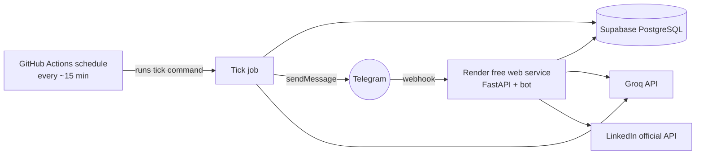
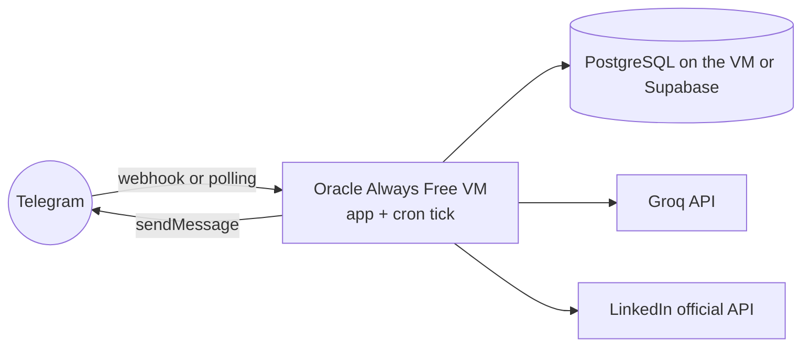

# 13 — Free Technologies and Deployment

**Version:** 0.1 — 20 October 2026
**Related files:** `03-tech-stack.md`, `06-system-architecture.md`, `12-implementation-plan.md`, `15-open-questions.md`
Evidence labels: `01-project-vision.md` section 1. "Checked" dates: **V** = opened by me on 2026-10-20; **B** = the brief's reading on 2026-10-20, not re-opened by me. Free limits change, so **re-check every pricing page right before you rely on it**.

> **Honest summary:** I found **no hosting option that is confirmed to be free, always on, and allowed for production.** Render says its free instances are not for production and they sleep (V7). Oracle's Always Free VM is the most "always-on" candidate but its signup requirements and capacity are unconfirmed. A bot that sometimes wakes slowly or misses a briefing is a realistic outcome of a zero-cost goal. Nothing here guarantees 24/7 uptime.

---

## 1. Hosting and runtime candidates

| Candidate | Free limits | Card needed? | Sleeps / pauses? | Local files persist? | Long-running Python? | Scheduled jobs? | Outbound HTTPS to our APIs | Commercial / data-use | Evidence |
|---|---|---|---|---|---|---|---|---|---|
| **Render free web service** | 750 instance hours per month per workspace; suspended when hours run out; unused hours do not carry over | UNKNOWN — CHECK OFFICIAL DOCUMENTATION | **Yes**: spins down after 15 min of no inbound traffic; ~1 minute to wake | **No** (ephemeral; SQLite lost on restart/redeploy) | While awake | Not on free service as far as read; use an external trigger | UNKNOWN — CHECK OFFICIAL DOCUMENTATION | Render says **do not use for production**; for tests and hobby projects | **V7** |
| **GitHub Actions** (scheduled workflows) | Free on public repos with standard runners; private repos have a limited quota | UNKNOWN | Not a host; runs short jobs | No (fresh runner each run) | Short jobs only | **Yes** (cron schedule) | Expected yes; UNKNOWN | Public repo exposes code | B31 |
| **Oracle Cloud Always Free** | Up to two small AMD VMs, or an Arm VM up to 2 OCPUs and 12 GB total; you manage the Linux server | UNKNOWN — CHECK OFFICIAL DOCUMENTATION | No sleeping stated | VM disk expected to persist (UNKNOWN — verify) | **Yes** | Yes (system cron) | UNKNOWN | UNKNOWN | B34 |
| **Cloudflare Workers** | 100,000 requests/day; 10 ms CPU per request; 5 cron triggers per account; 50 subrequests per request | UNKNOWN | No sleep; short code only | No files | **No** (short requests); Python support on Workers: UNKNOWN | **Yes** (Cron Triggers) | Network waiting does not count toward CPU (B29/B30) | UNKNOWN | **V10** |
| **Railway** | Free plan: $1 credit per month; may run out for an always-on bot | UNKNOWN | Stops when credit ends | UNKNOWN | Yes while credit lasts | UNKNOWN | UNKNOWN | UNKNOWN | B35 |
| **PythonAnywhere free** | 1 web app; 100 CPU seconds; outbound internet only to an allowlist that includes `api.telegram.org` and `api.linkedin.com`; reduced features for free accounts from Jan 2026 | UNKNOWN | UNKNOWN | UNKNOWN | Limited | UNKNOWN | **Risk:** whether Groq, Gemini and RSS sites are on the allowlist is UNKNOWN | UNKNOWN | B36, B37 |
| **n8n Community (self-host)** | Software is free for personal projects, learning and research; needs a host; NOT tested | Depends on host | Depends on host | Depends on host | Needs a host | Has its own scheduler | Depends | License limits beyond personal use: see B40 | B40 |

## 2. AI providers

| Candidate | Free limits | Card? | Data use | Notes | Evidence |
|---|---|---|---|---|---|
| **Groq API** (selected primary) | Per-**organization** limits. The page's table is headed Free/Developer but shows one set of values (example row: `openai/gpt-oss-120b`: 30 requests/min, 1,000/day, 8K tokens/min, 200K tokens/day — **may not be your plan**). Your real limits are in your own console: `UNKNOWN — CHECK OFFICIAL DOCUMENTATION` | UNKNOWN | By default Groq does **not** retain inference data; kept up to 30 days for reliability or abuse checks; Zero Data Retention switch exists. **Whether Groq trains on inputs: UNCONFIRMED** | **Multiple accounts to exceed limits are prohibited** (AI Policy effective 15 Oct 2025). One account only. | **V4, V5, V6** |
| **Gemini API free tier** (optional fallback, OFF) | Page shows "limited access to certain models", no numbers; check Google AI Studio dashboard (B28) | UNKNOWN | **Free tier content is used to improve Google products (Yes)**; Search grounding not available on the listed free models | Public text only | **V9** (first 100,000 of 126,749 characters read) |

## 3. Data, libraries and tools

| Candidate | Free / freemium | Key limits and facts | Decision | Evidence |
|---|---|---|---|---|
| **Supabase free (PostgreSQL)** | Freemium | Projects with low activity for 7 days are paused; warning email about a week before; restore possible for up to 1 year via dashboard; free project count and storage: brief says 2 projects (B38/B39), not re-opened | **Selected** for production | **V11** |
| **PostgreSQL (generic)** | Free software | Needs a host; Supabase supplies one | Selected via Supabase | — |
| **SQLite** | Free | File on disk; lost on Render free restarts | **Local dev and tests only** | V7 |
| **SQLAlchemy, Alembic** | Free, open source | — | Selected | not opened |
| **APScheduler** | Free library | Needs an always-running process | **Not selected** (tick design) | not opened |
| **python-telegram-bot** | Free | — | **Selected** | B25 |
| **aiogram** | Free | — | Alternative | B25 |
| **grammY (TypeScript)** | Free | Library's own page claims TypeScript is better (opinion, B26) | Not selected (Python preferred) | B26 |
| **FastAPI** | Free | — | Selected (webhook and callback) | not opened |
| **Telegram Bot API** | Free | ~1 message/second per chat; photos up to 10 MB, files up to 50 MB (direct upload) | Required | B22, B23 |
| **GitHub (repo)** | Free | Public repo exposes code, never put secrets in it | Selected | B31 |
| **Google Antigravity (personal plan)** | Free | Weekly rate limit depends on task size; limits can change; **it is where code is written, not where the bot runs**; its agent does not know LinkedIn's rules and may write a scraper if asked to "automate LinkedIn" | Dev environment | B41 to B43 |

## 4. Selected option and rationale

- **Start with Architecture B** below. Reasons: no server to administer, a free HTTPS address for the Telegram webhook and the LinkedIn sign-in callback, and sleeping is acceptable because webhooks wake the service.
- **Keep Architecture A as the upgrade path** if wake delays, hour limits or the "not for production" warning become a problem.
- **Reject** Cloudflare Workers (10 ms CPU, no Python guarantee), Railway (credit may run out), PythonAnywhere (outbound allowlist may block AI and RSS hosts) for now.

## 5. Architecture B — "sleeping web app + external timer" (recommended start)

**Planning-level deployment steps**
1. Put code in a GitHub repository (public gives free scheduled runs; private has a limited quota, B31).
2. Create a Supabase project; keep the database URL secret (V11 pause rules apply).
3. Create the Render web service from the repo; add secrets in Render's environment settings.
4. Register the Telegram webhook with the service URL and a `secret_token` (V8).
5. Add the GitHub Actions schedule that runs the tick; add the same secrets as GitHub Secrets.
6. Register the LinkedIn redirect URL (the Render address) in the developer app.
7. Test: cold start, stranger test, tick, briefing.

| Pros | Cons |
|---|---|
| No server administration | Render says not for production; sleeps after 15 idle minutes; ~1 minute wake |
| Free HTTPS address | Files lost on restart: everything must be in Supabase |
| Easy rebuild from Git | GitHub schedule timing is not exact (UNCONFIRMED); in a public repo the schedule switches off after 60 days without activity, and forks start with schedules off (**VERIFIED**, V13) |
| Works with webhooks | Secrets live in two places (Render and GitHub) |

## 6. Architecture A — "one always-on free VM"

**Planning-level steps**
1. Create the Oracle account (card and identity needs: UNKNOWN — CHECK OFFICIAL DOCUMENTATION).
2. Create the free VM (capacity availability: UNKNOWN).
3. Secure the server: updates, firewall, no password SSH, non-root user.
4. Run the app as a service; run the tick with cron or a systemd timer.
5. HTTPS for the LinkedIn callback needs a domain name and certificate: free options **UNKNOWN**; LinkedIn's rules for non-HTTPS redirects: UNKNOWN — CHECK OFFICIAL DOCUMENTATION. (Long polling does not need HTTPS, but sign-in does.)
6. Backups of the database off the VM.

| Pros | Cons |
|---|---|
| Truly always on if it works | You manage Linux, updates and security (more risk for a beginner) |
| Files persist on the VM | Signup and capacity are unconfirmed |
| Exact timers with cron | Bigger attack surface; one more thing to monitor |

## 7. Failure scenarios

| Scenario | What happens | Mitigation |
|---|---|---|
| Render sleeps | First message takes about a minute | Accept; tell owner in `/help` |
| Render hours used up | All free services suspended until next month (V7) | One service only; watch usage |
| Supabase pauses | Bot errors on database access (V11) | Daily tick counts as activity (not guaranteed); weekly check; restore from dashboard |
| GitHub schedule delayed or stopped | Briefing late or missing | Catch-up logic; `/status` shows last tick; manual `/report` |
| Groq quota hit or key blocked | No summaries | Headline-only fallback (FR-022); do not use extra accounts |
| LinkedIn token ends (60 days) | Publishing stops | Warnings and `/connect` (V3) |
| Free tier changes | Surprise cost or removal | Monthly check of pricing pages; export database |
| Secrets leak | Account risk | `10-agent-rules.md` runbooks |
| Public repo has no activity for 60 days | GitHub switches off the scheduled tick (V13); briefings silently stop | Warning in `/status` when ticks stop; re-enable the workflow; or use Architecture A's cron |
| A new user forks the repo | Their schedule starts disabled (V13) | `SETUP-GUIDE.md` step to enable Actions and the schedule |

## 7A. Public repository, forks and "use your own keys" (D-2)

| Topic | What to know | Evidence |
|---|---|---|
| Forks and schedules | Scheduled workflows are disabled by default when a public repository is forked. Each person must enable Actions and the schedule in their own copy. | V13 |
| Quiet repositories | Scheduled workflows in a public repository are automatically disabled after 60 days with no repository activity. A healthy bot can silently lose its daily tick. Options (all PROPOSED, none tested): use Architecture A's cron; re-enable by hand when `/status` warns; keep a private copy (limited minutes, B31). What counts as "activity": UNCONFIRMED — CHECK OFFICIAL DOCUMENTATION. | V13, B31 |
| Secrets in forks | Secrets are not passed to workflows triggered from forks (except `GITHUB_TOKEN`, read-only on fork pull requests). CI tests therefore use fake values; each owner adds their own secrets in their own repository settings. | V12 |
| Template or fork | Behaviour of a repository created from a template: UNCONFIRMED — CHECK OFFICIAL DOCUMENTATION | — |
| Everyone's own accounts | Each owner needs their own Telegram bot, Groq account, database project, host and (optional) LinkedIn Page and app. Free limits are per owner, so the maintainer's quota is never shared. | V4, V6, V11, B44 |
| Maintainer's cost | No shared server, so hosting cost is zero. Support time is not zero. | — |

## 8. Cost risks

- Any service may start asking for a card or end its free tier. **Record the date and page** each time you check.
- Render free Postgres expires 30 days after creation (V7) — **do not use it**; use Supabase.
- Exceeding Render hours, GitHub private-repo minutes or Groq limits can stop things, and moving to paid plans would break the zero-cost goal.
- A paid search or research API is out of scope.

## 9. Alternatives

n8n self-hosted (untested), a home computer or an old phone running 24/7 (free but unreliable and a security risk if exposed), running only **on demand** from your laptop (no briefing when it is off), or the minimal version: **Telegram bot only on your laptop with `/report` pulled by hand**.

## 10. Sources

V4 https://console.groq.com/docs/rate-limits, V5 https://console.groq.com/docs/your-data, V6 https://console.groq.com/docs/legal/ai-policy, V7 https://render.com/docs/free, V9 https://ai.google.dev/gemini-api/docs/pricing, V10 https://developers.cloudflare.com/workers/platform/limits/, V11 https://supabase.com/docs/guides/platform/free-project-pausing, V12 https://docs.github.com/en/actions/reference/workflows-and-actions/events-that-trigger-workflows, V13 https://docs.github.com/en/actions/how-tos/manage-workflow-runs/disable-and-enable-workflows.
BRIEF-VERIFIED: B22 https://core.telegram.org/bots/faq, B23 https://core.telegram.org/bots/api, B25 https://core.telegram.org/bots/samples, B26 https://grammy.dev/resources/comparison, B28 https://ai.google.dev/gemini-api/docs/rate-limits, B29 https://developers.cloudflare.com/workers/platform/limits/, B30 https://developers.cloudflare.com/workers/platform/pricing/, B31 https://docs.github.com/en/billing/concepts/product-billing/github-actions, B34 https://docs.oracle.com/en-us/iaas/Content/FreeTier/freetier_topic-Always_Free_Resources.htm, B35 https://docs.railway.com/pricing/plans, B36 https://www.pythonanywhere.com/whitelist/, B37 https://blog.pythonanywhere.com/221/, B38/B39 https://supabase.com/docs/guides/platform/billing-on-supabase, B40 https://docs.n8n.io/n8n-community-license/community-license/license-faq, B41 https://antigravity.google/docs/getting-started, B42 https://antigravity.google/docs/plans, B43 https://antigravity.google/pricing.

## What I skipped or could not check

- I did not open Oracle, Railway, PythonAnywhere, GitHub Actions, n8n or Antigravity pages; their rows are BRIEF-VERIFIED only.
- Payment-method requirements for nearly every service: UNKNOWN.
- Render outbound networking, Render cron on free tier, Oracle capacity, GitHub schedule reliability: UNKNOWN.
- Gemini page: last part unread (26,749 characters).
- Groq real limits for your plan and training policy: unknown.
- Your decisions: Architecture A or B; public or private repo; whether to accept sleep delays.
- What counts as "repository activity" for the 60-day rule, and how template repositories behave, are not confirmed (V13 covers forks and public-repo inactivity only). LinkedIn API Terms (B46) could not be read.
